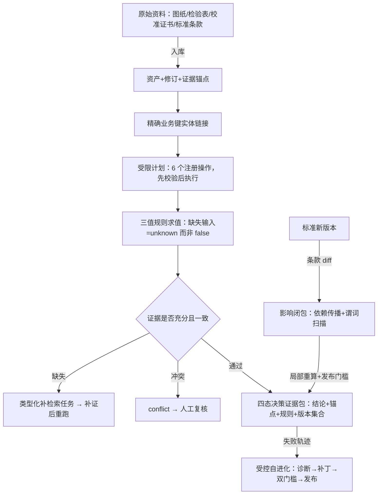

# Nexent 领域资产认知与决策系统

面向**制造业质量证据审核**的领域智能体系统：把产品图纸、检验表、校准证书、标准条款等跨文档资料统一为可追溯的资产与证据，对质量决策输出**四态结论**（合格 / 不合格 / 证据不足 / 证据冲突），并在标准版本更替后自动定位需重审的历史结论、局部重算、受控发布。

系统作为领域 MCP 服务与 Skill 包接入 **Nexent** 平台运行：Agent 负责对话与编排，本系统负责证据、规则与裁决——**确定性程序做判定，大模型只做解释与候选**。

## 赛题

**华为 ICT 大赛创新赛创新赛题三：「基于华为 ModelEngine Nexent 打造可进化决策智能体」**

要求矩阵归纳自赛题任务正文（详见 [docs/master-plan.md](docs/master-plan.md) 第 1 节）：

| 赛题要求 | 本系统对应 |
|---|---|
| 文本、表格、图文统一识别与资产标识 | 资产/修订/实体/事实四级身份分离，每个事实带原文锚点（单元格/条款/字符区间） |
| 低资源本体半自动构建与动态更新、标准对齐 | 种子本体 + 候选抽取 + 约束校验 + 审核队列的流水线；标准版本驱动影响分析 |
| 深度集成 Nexent MCP 与 Skills | 7 个领域 MCP 工具 + 2 个 Nexent 原生 Skill 包，已在运行中的 Nexent 验证 |
| 检索—推理双驱动 | 受限计划执行 + 证据缺口驱动的类型化补检索任务 |
| 跨文档多跳推理与决策溯源 | 决策证据包：结论、锚点、规则、版本集合全留痕，可回放重算 |
| 可复用 Skill 模板 | 领域配置（列映射/单位/标准适用）与核心流程分离，第二组织模板零代码迁移 |
| Nexent 平台可运行 | 已接入本地部署的 Nexent 并完成真实对话执行验证 |

官方入口：[华为 ICT 大赛创新赛页面](https://e.huawei.com/cn/talent/#/ict/innovation-details?zoneCode=027425&zoneId=98269700&compId=85132021)

## 系统能做什么

**1. 跨文档质量证据审核（T1）**
对某批次回答"当前证据支持什么处置"：关联图纸特征 → 检验测量值 → 仪器校准状态 → 适用标准条款，输出四态结论与逐条锚点。关键的保守语义：

- 测量发生在校准有效期外 → **unknown**（检验有效性待复核），数值落在容差内也不判合格
- 单位混用（μm/mm）由确定性换算表处理，不可换算 → unknown
- 同批次出现两条可信但相反的测量 → **conflict**，不强行二选一
- 证书撤销或权限收回 → 已有结论降级 unknown，被撤证据绝不留在证据包里

**2. 标准变更影响分析（T2）**
标准发布新版本时：逐条款 diff（新增/替代/废止/缩范围/仅排版）→ 双路径影响闭包（依赖传播 + 新适用谓词扫描，后者能命中从未引用旧规则的对象）→ 只重算受影响的决策、其余逐字保留 → 三重发布门槛（新条款证据可用、局部重算与全量重算等价、影响漏检检测）不过则整体回滚。重新上传旧版标准文件不会"复活"已废止规则。

**3. 证据缺口补证闭环**
结论为 unknown 时自动生成类型化补检索任务（缺什么类型的资产、覆盖哪个对象、什么时间窗、用途是什么），补入证据后重跑计划即得确定结论——已在样例中验证 unknown → refuted 的完整闭环。

**4. 领域 MCP 工具服务**
三个服务边界、7 个工具：资产与证据（`search_assets`/`get_evidence`/`resolve_entity`/`read_table_region`）、本体与标准（`analyze_change_impact`）、决策与验证（`execute_plan`/`replay_decision`）。身份与可见范围由服务端注入——工具参数携带 `tenant`/`labels` 直接被拒；受限证据返回与"不存在"不可区分的 `not_found`，不泄漏存在性；每次调用留痕（run_id/耗时/证据引用）。

**5. Nexent 原生 Skill 包**
`cross-document-check`（T1 审核）与 `standard-change-impact`（T2 影响分析）：SKILL.md 兼容 Nexent SkillLoader（已用真实加载器验证），版本/权限/副作用契约放独立 manifest.json 并由验证器强制执行（未注册工具/本体/标准版本、越权副作用均拦截）。领域配置（列映射、单位别名、标准适用）在 `config/domain.yaml`，换组织模板不改核心代码。

**6. 受控自进化**
运行失败 → 责任层定位（数据问题路由补检索，不掩盖成 Skill 问题）→ 受限候选补丁（白名单 4 类；权限/验收集/判定语义永不可自动改）→ 隔离验证双门槛（目标案例必须修复 + 基线案例零回归）→ 通过才发布新版本，失败保留旧版。答案走私、锁定测试来源、错误换算因子三类坏补丁均有拦截测试。

## 工作原理



核心设计原则：

- **检索未找到 ≠ 命题为假**；只有明确采用闭世界假设的规则才允许把缺失判为否
- **放行需全部证据可信且合格，拦截只需一条可信超差**——不对称聚合，宁可复核不可放行
- **先验证后切换**：知识发布（本体/标准/Skill）必须过回归门槛，失败保留旧版本
- **版本集合入包**：每个决策记录当时依据的本体/规则/标准/资产修订，支持"当时已知"与"按当前知识重算"两种视图

## 项目结构

```text
src/competition/
  contracts/    # 12 类领域数据契约：资产/修订/锚点/实体/事实/本体/条款/对齐/规则/决策/变更集/Skill发布
  pipeline/     # 入库锚点、实体链接、三值规则求值、T1 决策包组装
  planning/     # 受限计划（注册操作+静态校验+执行留痕）、证据缺口补检索
  ontology/     # 种子本体、候选抽取、约束校验、可执行能力问题、审核队列、发布门槛
  evolution/    # 条款 diff、双路径影响闭包、局部重算对照全量、发布门槛与回滚
  skills/       # Skill manifest 契约、包加载器、验证适配器
  adaptation/   # 失败诊断定责、受限补丁审计、隔离验证双门槛、发布/回退
  mcp/          # 领域 MCP 工具层：注册表、权限模型、FastMCP 桥
skills/         # 两个 Nexent 原生 Skill 包（SKILL.md + manifest + schemas + evals + scripts）
data/           # 合成验收样例：组织 A（含标准两版本）/ 优化集 / 组织 B 模板
tests/          # 112 个测试：契约 / 端到端 / 计划 / 演化 / 本体 / 适应 / MCP / 技能 / 迁移
docs/           # 设计文档、任务规范、基线记录、迁移报告、平台接入证据、对话流归档
```

## 快速开始

```bash
cd competition
uv sync                 # 创建虚拟环境（Python ≥ 3.11）
uv sync --extra mcp     # 可选：安装 FastMCP（MCP server 桥）
uv run pytest           # 运行全部 112 个测试
```

**T1 审核演示**（合成样例：图纸 A + 检验表 B + 校准 C + 规范 D 两版本）：

```bash
echo '{"batch_no": "L-2026-10"}' > /tmp/job.json
uv run python skills/cross-document-check/scripts/run_check.py \
    --input /tmp/job.json --scenario data/scenario_d
# -> status: "supported"（0.0048mm ≤ 0.005mm，量具校准有效，三源证据锚点齐全）

echo '{"batch_no": "L-2026-11"}' > /tmp/job.json   # 校准过期的批次
# -> status: "unknown" + missing_items: ["re-inspection: ..."]（数值不作裁决依据）
```

**T2 影响分析演示**（D-v2 缩紧容差、仅对生效日后订单适用）：

```bash
echo '{"standard_id": "SPEC-D", "old_version": "v1", "new_version": "v2"}' > /tmp/job.json
uv run python skills/standard-change-impact/scripts/run_impact.py \
    --input /tmp/job.json --scenario data/scenario_d
# -> 11 月订单批次 needs_review（重算后 refuted/conflict），9 月批次保持原判
```

## 接入 Nexent 平台

```bash
# http transport：容器侧 Nexent 经 host.docker.internal 访问
uv run python src/competition/mcp/server.py --transport http --host 0.0.0.0 --port 8765
```

Nexent 侧注册：`POST /api/mcp/add`（server_url=`http://host.docker.internal:8765/mcp`）→
`GET /api/tool/scan_tool` 工具入库 → 创建 Agent 绑定 7 个工具。

已在本地部署的 Nexent（upstream 基线 `5336b771`）完成真实对话验证：Agent 自主调用
`execute_plan`/`get_evidence`/`replay_decision`，对合格批次返回 supported 并给出三源锚点证据表，
对校准过期批次返回 unknown 并逐字引用缺失项。对话流原始归档见 `docs/evidence/`，
接入全程与修复记录见 [docs/platform-integration.md](docs/platform-integration.md)。

## 当前状态与边界

**已完成并验证**：上表全部能力均有实现与测试（112 个测试全绿）；平台级双场景执行通过；
第二组织模板（自有表头拼写/标准号/编号风格）零代码迁移，核心源码不含对方言字面量（硬断言）。

**如实声明的边界**：

- 验收样例为**合成数据**（明确标注 `synthetic: true`）——机制有效性已验证，真实企业资料接入与试标案例库（双人标注）尚未进行
- 多模态解析目前覆盖 JSON/CSV 结构化源；PDF/OCR/图像区域解析与解析器对比（Docling/PaddleOCR）未实现
- 与强基线（长上下文 LLM、调优 RAG、KAG、RAG-Anything）的对比评测未开展——在取得对比数据前，本 README 不作任何"优于 X"的表述
- Skill 包已通过 Nexent 真实 SkillLoader 解析验证，但平台 Agent 当前经 MCP 工具执行业务；Skill 包的平台装载链路待验证

## 文档索引

| 文档 | 内容 |
|---|---|
| [docs/master-plan.md](docs/master-plan.md) | 设计总蓝图：技术评审、分阶段路线、研究假设与实验协议 |
| [docs/g0-baseline/task-spec.md](docs/g0-baseline/task-spec.md) | T1–T3 任务规范：四态结论、E1–E4 错误等级、能力问题、试标模板 |
| [docs/g0-baseline/upstream-lock.md](docs/g0-baseline/upstream-lock.md) | Nexent 基线锁定与团队差异清单 |
| [docs/g0-baseline/data-manifest-template.md](docs/g0-baseline/data-manifest-template.md) | 数据分层盘点模板与划分规则 |
| [docs/migration-report.md](docs/migration-report.md) | 第二组织模板迁移实验：修改范围与复用证据 |
| [docs/platform-integration.md](docs/platform-integration.md) | Nexent 平台接入全程：架构、修复记录、运行证据 |
| docs/evidence/*.sse | 平台执行对话流原始归档 |
