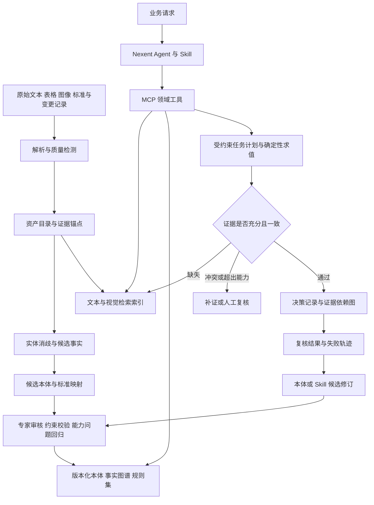

# 基于 Nexent 的领域资产认知智能体：技术评审与世界赛一等奖冲刺改进计划

> 研究与源码核查日期：2026-10-24。目标赛题：华为 ICT 大赛创新赛题三“基于华为 ModelEngine Nexent 打造可进化决策智能体”。任务细则以用户在本次对话中提供的正文为依据。
>
> 本文只讨论产品能力、技术路线、开源复用、研究创新、实验验证与工程交付，不包含路演、PPT、宣传和答辩训练。按用户要求，不以团队人数、预算、硬件和剩余时间约束技术路线；实施顺序采用依赖关系和验收门槛，不虚构排期。

## 0. 先给出判断

**推荐把项目做成“标准驱动、证据约束、可持续更新的领域资产决策系统”，以一条真实业务链贯穿多模态理解、低资源本体、标准对齐、跨文档推理和 Skills 复用。** 世界赛冲刺应追求的是：面对新材料、新实体和新标准，系统还能正确决定、指出依据、发现未知，并以可验证的方式改进。

目前提供的是 Nexent 公共仓库，尚未提供独立参赛仓库、团队开发差异、业务数据和实测结果。因此，本次能够评审的是 **Nexent 底座的适配能力与基于它参赛的技术路线**，不能把公共仓库中的所有功能归为团队成果，也不能对尚未看到的参赛实现给出完成度分数。

核心结论如下：

1. **Nexent 值得保留为运行底座。** 已有工具接入、Skill 装载与执行、知识检索、记忆、权限及执行检查等基础设施，应充分复用。[仓库固定快照](https://github.com/ModelEngine-Group/nexent/tree/5336b7719266b4e010299eff4c6bb9717042fddb)
2. **赛题最有区分度的部分在底座之上。** 资产身份与证据锚点、半自动本体工程、标准版本约束、决策依赖追踪，以及更新后的回归控制，应该成为自主实现重点。
3. **“有知识图谱”“会调用 MCP”“有多个 Agent”“能生成 Skill”属于能力描述，不能单独支撑领先性。** KAG、RAG-Anything、ACE、MCE 等已有工作覆盖了相邻技术，必须设计有竞争力的对照。[KAG](https://arxiv.org/abs/2409.13731)、[RAG-Anything](https://arxiv.org/abs/2510.12323)、[ACE](https://arxiv.org/abs/2510.04618)、[MCE](https://arxiv.org/abs/2601.21557)
4. **最值得集中攻克的三项候选优势：** 少标注条件下的标准约束本体演化；标准变化驱动的决策影响分析与增量修复；带执行契约、评测门槛和回滚机制的 Skill 演化。这些是本计划提出的研究假设，尚不是已证实的原创成果。
5. **推荐一个主行业做深，再做第二场景迁移实验。** 本文以“制造业质量异常与标准变更影响追溯”为主方案，医疗、金融、政务给出映射方式。这是技术选题建议，不是对团队既有应用方向的认定。
6. **一等奖是目标，不是可保证的结果。** 本文提出的验收线是内部技术目标，不是官方评分标准；未取得官方完整评分表，不编造权重、晋级线或世界赛额外技术要求。

### 0.1 事实、判断和目标的标记

| 标记 | 含义 | 本文使用方式 |
|---|---|---|
| 已核查 | 查看了固定源码或原始资料 | 只说明相应证据边界内的事实 |
| 待核验 | 缺少实现、真实运行或授权材料 | 不推断为不存在，也不推断为已完成 |
| 建议 | 本计划的设计选择 | 可按后续实验调整 |
| 研究假设 | 有相关文献启发但收益未验证 | 必须通过对照、消融与跨任务实验 |
| 验收目标 | 建议预先锁定的指标或条件 | 不是当前测量值，也不是获奖承诺 |

### 0.2 本次核查边界

- Nexent 默认分支为 `develop`；检查的提交为 `5336b7719266b4e010299eff4c6bb9717042fddb`，提交时间为 2026-10-23 17:51:06（UTC+8）。后续仓库可能变化，本文使用固定提交链接。
- 已进行：仓库浅克隆、只读源码与文档检查、主要扩展点检索、相关论文与开源项目原始来源核查、部分依赖许可证核对。
- 未进行：应用部署、模型调用、参赛项目测试、性能测量、安全渗透、全量代码审计。源码入口存在不等于真实业务闭环已经通过。
- 官方人才在线页面的文本抓取仅返回 JavaScript 页面壳；高校通知可旁证赛题名称，但用户提供的任务正文才是本次需求矩阵的直接输入。[赛事页面](https://e.huawei.com/cn/talent/#/ict/innovation-details?zoneCode=027425&zoneId=98269700&compId=85132021)、[高校通知](https://cs.bjut.edu.cn/info/1076/4323.htm)

## 1. 把赛题拆成可验收任务

| 赛题要求（依据用户正文归纳） | 最低完成状态 | 冲刺目标 | 验收证据 |
|---|---|---|---|
| 文本、表格、图文统一识别、理解与资产标识 | 能导入并检索多种文件 | 同一业务实体可跨文件、跨模态关联；每个事实返回原文/单元格/图像区域 | 资产登记表、实体对齐标注、定位正确率与错链案例 |
| 低资源本体半自动构建 | 少量标注与人工审阅可以建立本体 | 相同专家工时下覆盖更多正确概念、关系和约束，减少专家无效审核 | 标注预算曲线、专家工时、映射精确率、能力问题通过率 |
| 本体持续动态更新及标准对齐 | 有版本和人工修改入口 | 标准条款变更能定位受影响本体、事实、规则、历史决策，并局部修复 | 新旧版本差异、影响集合、回归结果、回滚记录 |
| 深度集成 Nexent MCP 与 Skills | 从 Nexent 发起真实工具调用和 Skill 执行 | Skill 选择、执行、异常处理、证据输出、版本绑定均可追踪 | 实际运行 trace、MCP 工具结果、Skill 内容摘要和版本 |
| 检索—推理双驱动 | 检索后回答问题 | 推理明确提出缺失证据，检索受类型、时间、权限和标准版本约束 | 检索计划、查询、证据缺口、补检索和终止记录 |
| 跨文档多跳推理与决策溯源 | 答案附来源 | 关键结论形成可执行、可检查的证据依赖图；矛盾/缺失会改变决策状态 | 多跳联合正确率、证据完整性、撤证测试、冲突测试 |
| 可复用且快速部署的 Skill 模板 | 可导入模板 | 更换领域配置和工具适配即可迁移，核心逻辑无需复制 | 干净环境部署、第二场景验证、修改范围统计 |
| Nexent 平台可运行 | 使用平台实际执行业务 | 主流程在 Nexent 运行，新增服务是能力扩展，可离线复现业务样例 | 安装清单、执行日志、端到端验收 |
| 入围中国总决赛后开源至 GitCode/GitHub | 源码公开且许可证明确 | 核心方法、可公开数据与评测能够被第三方重跑 | 版本化 release、NOTICE、数据许可、结果复现 |

**判定原则：** 每个要求至少对应一个实际执行的验收任务。文档中写了功能、前端画了图、代码中出现了函数名，都不能替代验收结果。

## 2. 基于源码的评审意见

### 2.1 应保留并利用的底座能力

| 核查对象 | 源码依据 | 可以复用什么 | 不能据此声称什么 |
|---|---|---|---|
| MCP 接入 | [nexent_agent.py](https://github.com/ModelEngine-Group/nexent/blob/5336b7719266b4e010299eff4c6bb9717042fddb/sdk/nexent/core/agents/nexent_agent.py#L562)、[managed_mcp.py](https://github.com/ModelEngine-Group/nexent/blob/5336b7719266b4e010299eff4c6bb9717042fddb/sdk/nexent/core/agents/managed_mcp.py) | 工具发现/绑定、上下文传递、连接和调用生命周期管理 | 接入 MCP 就实现了领域决策可靠性 |
| Skill 装载 | [skill_loader.py](https://github.com/ModelEngine-Group/nexent/blob/5336b7719266b4e010299eff4c6bb9717042fddb/sdk/nexent/skills/skill_loader.py#L12)、[skill_manager.py](https://github.com/ModelEngine-Group/nexent/blob/5336b7719266b4e010299eff4c6bb9717042fddb/sdk/nexent/skills/skill_manager.py) | SKILL.md 元数据、内容加载及管理 | 任意新增 YAML 字段都会被执行或校验 |
| Skill 执行与平台管理 | [run_skill_script_tool.py](https://github.com/ModelEngine-Group/nexent/blob/5336b7719266b4e010299eff4c6bb9717042fddb/sdk/nexent/core/tools/run_skill_script_tool.py)、[skill_app.py](https://github.com/ModelEngine-Group/nexent/blob/5336b7719266b4e010299eff4c6bb9717042fddb/backend/apps/skill_app.py) | 脚本执行入口、Skill 安装、上传、访问检查 | 所有部署路径天然具备同等隔离和故障恢复能力 |
| 文档解析与检索 | [data_process/core.py](https://github.com/ModelEngine-Group/nexent/blob/5336b7719266b4e010299eff4c6bb9717042fddb/sdk/nexent/data_process/core.py)、[knowledge_base_search_tool.py](https://github.com/ModelEngine-Group/nexent/blob/5336b7719266b4e010299eff4c6bb9717042fddb/sdk/nexent/core/tools/knowledge_base_search_tool.py#L26) | 文件处理、混合检索、可选重排与检索范围控制 | 支持多格式就解决了图文关系、跨表关联和业务实体统一 |
| 外部图谱能力入口 | [aidp_mgmt_app.py](https://github.com/ModelEngine-Group/nexent/blob/5336b7719266b4e010299eff4c6bb9717042fddb/backend/ext_components/aidp/apps/aidp_mgmt_app.py#L182) | AIDP 图谱开关与结构化图谱配置等集成入口 | Nexent 没有任何图谱能力；或已有完整可演化领域本体 |
| 记忆与运行检查 | [memory/](https://github.com/ModelEngine-Group/nexent/tree/5336b7719266b4e010299eff4c6bb9717042fddb/sdk/nexent/memory)、[verification.py](https://github.com/ModelEngine-Group/nexent/blob/5336b7719266b4e010299eff4c6bb9717042fddb/sdk/nexent/core/agents/verification.py) | 记忆检索、候选整理、验证反馈、guardrail 扩展 | 聊天记忆等于版本化行业知识；通用检查等于专业结论正确 |
| 运行证据采集 | [context/evidence.py](https://github.com/ModelEngine-Group/nexent/blob/5336b7719266b4e010299eff4c6bb9717042fddb/sdk/nexent/core/agents/context/evidence.py) | 模型调用及上下文处理的运行观测 | 运行日志本身就是业务结论的事实证明 |

源码中的 `SkillLoader` 只保留明确允许的元数据键：`name`、`description`、`allowed-tools`、`tags`、`script_outputs`。因此，后文提出的版本依赖、验收门槛、权限和副作用契约应放入新增的独立 manifest，并实现读取与强制执行适配，不能只写进 SKILL.md 就宣称生效。

本次对 `backend/`、`sdk/` 的关键词及相关入口检查，没有建立“已具备完整低资源本体构建—标准对齐—更新影响分析”的证据。这是检查范围内的证据缺口，不是对全部扩展服务的缺失断言。

### 2.2 优先处理的评审问题

| 优先级 | 评审意见 | 为什么影响竞争力 | 应采取的行动 |
|---|---|---|---|
| P0 | 团队贡献边界未呈现 | 公共平台能力无法证明团队创新 | 建立 upstream commit、团队 diff、第三方依赖、原创模块四类清单 |
| P0 | 场景容易停留在知识问答 | 问答无法充分体现资产激活和决策编排 | 明确决策对象、动作、后果、验收者和可观察业务结果 |
| P0 | 资产标识不能退化为文件 ID | 无法识别“不同文件描述同一批次/设备” | 区分文档 ID、版本 ID、实体 ID、观察值 ID、证据 ID |
| P0 | 本体、实例图谱与可视化必须分开 | 画出实体关系图不等于建立可约束业务的本体 | 分别交付类型/关系/公理、事实实例和展示视图 |
| P0 | 检索权重和模型置信度缺少校准证据 | 固定权重或模型自评分不能保证可靠 | 用开发集学习或调节策略；以错误率—覆盖率曲线评价拒答 |
| P0 | 动态更新不能仅追加文档 | 旧规则和旧结论可能继续生效 | 实现失效传播、适用时间、历史版本查询与局部重算 |
| P0 | 可追溯不能只有回答末尾链接 | 来源可能存在但不支持具体断言 | 每个关键结论关联定位锚点、规则、工具结果和版本 |
| P0 | 缺少“更新后仍正确”的实验 | 无法证明可进化而非越积越乱 | 保留旧任务回归集，区分应保留、应改变、应撤销的结论 |
| P1 | 多 Agent 数量可能大于实际需求 | 增加延迟和错误传播 | 先做职责分离的少量组件，按消融决定是否采用多 Agent |
| P1 | Skill 模板只有提示词可迁移性弱 | 工具、业务规则和数据路径可能被写死 | Skill 契约化；领域配置、工具适配与核心流程分离 |
| P1 | 评测可能被合成数据高分误导 | 合成模板与测试模板同源会夸大泛化 | 以真实授权资料为核心，按实体/来源/时间隔离测试集 |
| P1 | 部署成功与业务可复现易混淆 | 服务健康但关键任务可能无法完成 | 在新环境从资产导入跑到决策回放并核对输出 |

仓库还包含 `pathology-ai/` 示例，其文档自称其他学习赛项目。**不应默认它就是用户的参赛作品。** 其中“首创”与临床效果类表述不能直接沿用；其置信度实现可见基于证据数量、症状映射等规则的评分，不能据此称为经校准的医学概率。该例子提醒我们：流程命名、来源标签和评分卡都需要外部验证支持。[示例说明](https://github.com/ModelEngine-Group/nexent/blob/5336b7719266b4e010299eff4c6bb9717042fddb/pathology-ai/README.md)、[评分实现](https://github.com/ModelEngine-Group/nexent/blob/5336b7719266b4e010299eff4c6bb9717042fddb/pathology-ai/code-changes/medical_extension/confidence_evaluator.py)

## 3. 产品定位：用一个高价值决策闭环承载技术

### 3.1 推荐主场景：制造业质量异常与标准变更影响追溯

建议系统回答的核心问题：

> 某批次出现质量异常，哪些零件、供应商、工艺和检验依据与异常相关？当前证据足够支持什么处置？规范更新后，哪些历史合格结论需要重审、哪些不受影响？

选它的技术理由：有图纸/图像、PDF 规范、BOM 与检验表、工艺记录和变更单；同一对象跨文档反复出现；单位、版本、适用范围和生效日期会实质改变结论；多跳追踪可以落在明确业务对象上。这是基于任务结构的方案判断，不是对其市场规模或经济收益的实证结论。

**业务边界：** 首先做质量证据审核与处置建议、复检任务草稿和影响清单。生产线停机、批量报废、供应商处罚等操作保持人工授权。完成“问题—分析—建议—复核—反馈”闭环，不用高风险自主执行制造噱头。

### 3.2 三个必须完成的业务任务

| 任务 | 输入资产 | 推理路径 | 业务输出 |
|---|---|---|---|
| T1：跨文档质量证据审核 | 产品图纸、检验表、校准记录、适用规范 | 产品特征 → 检验项 → 测量值/单位 → 仪器与校准 → 适用标准条款 | 合格/不合格/证据不足/冲突，附可定位依据 |
| T2：标准变更影响分析 | 旧标准、新标准、历史记录、历史决策 | 条款差异 → 受影响概念与规则 → 相关资产 → 历史决策 → 复核任务 | 必须重审、无需重审、适用范围待确认三类清单 |
| T3：异常关联与复检计划 | 异常报告、批次谱系、工艺、供应商证明 | 异常现象 → 相关批次/工艺 → 支持与反对证据 → 候选原因 → 最小补证项 | 有限排序的原因假设、证据缺口、复检建议草稿 |

T3 的输出默认是“原因假设”，关联不能称为因果。只有受控实验、领域机制或适当识别设计支持时，才升级为因果结论。

### 3.3 可执行的贯穿样例

以下完全是**合成验收样例**，不代表真实标准或真实企业记录：

1. 图纸 A 给出零件 P 的特征 F；检验表 B 记录批次 L 的 F 测量值；校准文件 C 记录仪器 M 的有效期；规范 D-v1 给出容差和适用范围。
2. 系统必须将四份资料关联到同一业务对象，保留测量值、单位、时间、页码与单元格位置。
3. 若 B 的测量发生在 C 的有效期之外，应标记“检验有效性待复核”，不能只因数值落在容差内就判合格。
4. D-v2 缩紧某范围的容差，但只对指定生效日期后的订单适用。系统应重审符合适用条件的决策，并保持其他历史结论。
5. 若删除 C 或撤销访问权限，应输出“证据不足/当前无权限验证”，不能沿用缓存中的已知结论；已有受限信息也不能被新报告泄漏。
6. 审核人修正某型号别名映射后，系统提出局部修复补丁；通过回归才发布，不把一次反馈扩大为全行业规则。

这个样例会同时暴露实体错配、OCR 错误、单位错误、时间误用、标准误用、撤证失败和缓存污染，适合作为最早的端到端验收。

### 3.4 若采用其他行业，保持核心机制不变

| 行业 | 建议切口 | 标准对齐与动态变化 | 主动避免的偏题 |
|---|---|---|---|
| 医疗 | 病理/检验资料完整性审核、证据归档与规范符合性辅助 | 项目编码、报告模板、指南版本、适用人群 | 泛化“自动诊断”；把规则分数当临床概率 |
| 金融 | 财报、附注、公告与业务规则的交叉核验 | 会计概念、披露口径、报告期和规则版本 | 单纯股票预测；用收益率替代资产认知验收 |
| 政务 | 跨部门材料一致性核验与政策适用辅助 | 事项要素、材料目录、地区与生效日期 | 通用政策聊天机器人；自动作出行政决定 |
| 制造 | 质量异常、检验有效性和规范变更追溯 | 资产标识、检验特征、标准条款和版本 | 只有缺陷识别模型；没有文档/规则闭环 |

第二场景优先选择同一行业的另一产品族或另一组织模板；它比一开始同时建设四个行业更容易隔离“可复用流程”与“专门为样例写的规则”。跨行业迁移作为更强的后续验证。

## 4. “人无我有；人有我优”的可检验定义

不能知道所有参赛队具有什么能力，也没有系统检索证明某组合全球首次。因此将这句话改写为两组工程目标：

- **差异化能力：** 在已选强基线未直接覆盖的任务边界上，提供完整且可验证的增量能力。
- **比较优势：** 对已经普遍具备的能力，在相同模型、数据和资源约束下取得可复现的质量、成本或可靠性优势。

| 能力 | 已有工作提醒 | 本项目应争取的增量 | 成立证据 |
|---|---|---|---|
| 多模态检索 | ColPali、RAG-Anything 已有相关方法 | 视觉区域/表格单元格与业务实体、规则、决策统一关联 | 原始视觉证据定位、跨模态联合任务显著增益 |
| 图谱与多跳推理 | KAG、GraphRAG、HippoRAG 2 已覆盖相邻路径 | 标准版本与适用范围约束下的可执行决策依赖图 | 与强图谱基线比较，同时验证证据和结论 |
| 本体辅助推理 | ORACLE 已研究按问题构造本体与逻辑链 | 持久领域本体的增量治理、标准映射和历史决策影响分析 | 问题级动态本体与持久本体版本治理分开对照 |
| 本体对齐 | 2026 EACL 工作已研究 LLM 辅助不确定映射验证 | 将专家预算用于高影响、不确定、可能引发错误决策的映射 | 同专家工时的决策风险下降和映射质量改善 |
| 自进化 | ACE、GEPA、MCE 已研究上下文/提示词/Skill 优化 | 本体与 Skill 受共同版本约束，候选更新经独立回归后发布 | 优化集之外有效、旧任务不明显退化、可拒绝坏补丁 |

研究依据：[ColPali](https://arxiv.org/abs/2407.01449)、[KAG](https://arxiv.org/abs/2409.13731)、[GraphRAG](https://arxiv.org/abs/2404.16130)、[HippoRAG 2](https://arxiv.org/abs/2502.14802)、[ORACLE](https://aclanthology.org/2026.findings-acl.687/)、[本体对齐](https://aclanthology.org/2026.eacl-long.110/)、[GEPA](https://arxiv.org/abs/2507.19457)。这里比较的是论文明确提出的机制，不是宣称这些系统绝不可能扩展实现上述能力。

### 4.1 三项研究假设与淘汰条件

**H1：标准约束的主动本体修订。** 从数据中发现候选概念与关系；结合标准条款、类型约束和历史错误，将有限专家审核集中在高价值位置。

- 对照：人工种子本体＋随机审核、纯 LLM 扩展、只按置信度选择审核。
- 指标：相同专家分钟数下的映射 F1、错误决策率、能力问题通过率。
- 淘汰条件：只增加复杂度而没有稳定降低审核成本或决策错误；则保留标准映射与人工审核，去掉复杂采样算法。

**H2：标准变化驱动的影响闭包与局部重算。** 把标准条款、本体约束、抽取结果、推理规则、Skill 和决策组成依赖图，更新后只重做受影响部分。

- 对照：静态 RAG、增量文档索引、全量重建重算、只有时效过滤的图谱系统。
- 指标：影响识别精确率/召回率、过期结论残留率、重新计算成本、未受影响任务退化。
- 淘汰条件：局部重算漏掉关键影响，或成本接近全量而可靠性更低；退回全量重算，不以效率牺牲正确性。

**H3：带契约与回归门槛的 Skill 演化。** 从失败轨迹产生候选修改，限制在允许的流程/参数/提示词范围，绑定本体和工具版本，经验证后发布。

- 对照：静态 Skill、人工优化 Skill、GEPA/ACE 风格优化、MCE 或其双层 Skill/上下文演化机制的可复现适配、无回归门槛的自动更新。若无法复现或公平适配 MCE，记录接口与任务差异，并将结论限于已完成对照，不能声称优于这一近邻方法。
- 指标：新任务收益、旧任务保持、坏更新拦截率、跨模板迁移、单成功任务成本。
- 淘汰条件：收益只存在于优化集，或依赖测试答案泄漏；保留静态已验证 Skill，把自动优化降级为建议。

## 5. 目标架构与数据契约

### 5.1 架构原则

1. Nexent 负责会话、Agent、MCP、Skills 和执行过程；领域服务负责资产、本体、规则和决策证据。
2. 保留源文件和原始结构；派生文本、图谱、向量是可重建索引。
3. 关键规则由确定性程序执行，LLM 负责候选抽取、任务分解、证据补齐和说明。
4. 事实、规则、推断、假设分开保存。每个推断保留它依赖的事实和规则。
5. 正式知识和候选知识分区；发布必须形成一致版本，不能边审核边污染在线答案。
6. 运行权限、版本和证据可见性由服务端执行，不依赖提示词自觉遵守。



图中的“通过”只表示满足当前任务的验收条件，不能表示客观真理或绝对正确。

### 5.2 建议的数据对象

下表是**拟新增的领域契约**，不是 Nexent 现有接口说明。

| 对象 | 必备字段/内容 | 关键约束 |
|---|---|---|
| Asset | `asset_id`、来源系统、业务键、类别、责任方、权限标签 | 业务标识与文件名分离；跨系统映射需保留依据 |
| AssetRevision | `revision_id`、文件摘要、采集时间、有效时间、替代关系 | 内容摘要用于版本识别，不证明内容真实 |
| EvidenceAnchor | 文档版本、页码/区域/单元格/字符区间、原始值、解析器版本 | 锚点指向确定版本；原文保留；坐标可回看 |
| Entity | 稳定 ID、类型、别名、外部标识、合并/拆分历史 | 同名不同物不得自动合并；支持取消合并 |
| FactAssertion | 主谓宾、单位、条件、有效期、来源、状态、抽取置信度 | 同一命题可有多个冲突来源；预测关系不自动成为事实 |
| OntologyRelease | 类、关系、约束、能力问题、标准映射、版本 | 本体版本与图谱实例版本独立，记录兼容关系 |
| StandardClause | 标准标识、版本、条款号、适用范围、生效/失效时间、来源 | 同名称不同版本独立；未确认适用性不能直接裁决 |
| Alignment | 本地概念、目标标准概念、映射类型、理由、审阅状态 | 区分等价、上下位、相关、不可映射；相关不等于等价 |
| Rule | 输入类型、前置条件、可执行表达、单位和时间语义 | 引用标准依据；缺失输入产生 unknown 而不是 false |
| SkillRelease | Skill 包、工具契约、本体范围、规则版本、验收集 | 发布后不可原地改写；变更产生新版本 |
| DecisionRecord | 结论、状态、前提、证据、规则、执行轨迹、版本集合 | 可以逐条复核；保存“当时已知”与“按当前知识重算”两种视图 |
| ChangeSet | 变更项、来源、受影响集合、迁移方案、回归结果、审核人 | 先验证再切换；失败保留旧发布版本 |

### 5.3 存储选型：每类数据有一个权威来源

- **对象存储：** 复用现有 MinIO 体系存源文件、页图、解析产物和证据包。
- **关系库：** 复用 PostgreSQL 存资产登记、版本、审批、决策记录和依赖边；领域表使用明确命名空间或独立 schema。
- **文本/向量检索：** 优先复用现有 Elasticsearch，避免仅为“技术栈丰富”再增加第二套向量库。
- **语义约束：** 本体发布为 RDF/OWL 的受控子集及 SHACL shapes；选用 RDFLib/pySHACL 做离线验证。需要额外逻辑推理时再引入受支持的推理器。
- **图查询：** 首版在统一领域服务下选定一种实现。可先使用关系边表与受限遍历；如果性能或逻辑能力确有需要，再采用 OpenSPG/KAG 或专门图数据库。不要同时维护多套可写“真图谱”。
- **索引一致性：** 每个索引带 `release_id`；正式请求读取同一发布快照。使用任务队列/outbox 重建投影，发布前核对版本与完成状态，避免数据库已更新而向量索引仍旧。

SHACL 能检查指定形状约束，但不能证明数据事实真实，也不等价于完整 OWL 逻辑一致性检查。采用什么逻辑片段、是否允许否定和递归、采用何种闭世界假设，必须在规则契约中写清楚。[SHACL 规范](https://www.w3.org/TR/shacl/)

## 6. 工作包 A：多模态资产认知与可靠标识

### 6.1 实现步骤

1. **资产入库。** 接收 PDF、图片、DOCX、XLSX/CSV 等；提取来源、业务类型、版本、时间与权限，记录解析失败原因。先覆盖主场景必需格式，再扩展。
2. **双通道解析。** 原生 PDF/表格优先读取结构；扫描件走 OCR 与版面分析。复杂页面保留页图并允许视觉模型辅助，不把图像描述当作无误事实。
3. **结构保持。** 保留标题层级、页序、表头、合并单元格、脚注、单位、图注与图文邻接关系。表格的数值必须带行列语义，不能只拼成散乱文本。
4. **质量路由。** 用字符异常、列数不一致、关键字段缺失、单位冲突、解析器分歧等信号触发二次解析或人工检查。禁止用一个未经校准的“质量分”掩盖具体失败。
5. **统一资产识别。** 优先使用可靠业务键（型号、批次、订单、设备号），再使用名称/属性/时间/来源组合匹配；需要合并的低置信候选进入审核。
6. **证据锚定。** 每个抽取事实绑定原文位置；标准条款定位到版本与条款；表格定位到工作表/行列和表头；图片保留区域及识别理由。
7. **索引建立。** 文本混合检索作为基础；视觉检索作为图纸、复杂表格和图像问题的补充通道；按开发集效果决定融合方式。

### 6.2 必须解决的易错情形

| 错误类型 | 处理要求 | 验收方法 |
|---|---|---|
| `0.05` 被识别成 `0.5` | 保留原图；关键阈值/测量值增加格式与量纲检查 | 注入小数点/负号错误，统计发现率和错误放行 |
| 同一表格跨页 | 继承正确表头，记录跨页连接依据 | 人工标注跨页表，检查合并和误合并 |
| `μm` 与 `mm` 混用 | 存原值和标准化值，由程序换算 | 精确数值测试及边界容差测试 |
| 型号相近或同名不同批次 | 不靠语义相似度直接合并 | 同名异物、别名同物成对测试 |
| 旧证书在新目录重复出现 | 以证书版本及有效期识别 | 新文件名但旧内容、相同内容不同业务权限测试 |
| 图像说明与实际图像冲突 | 两种证据并存并标冲突 | 人工构造冲突集，不允许静默选择 |

### 6.3 解析器试验与交付

以同一批真实版式样本比较 Docling、PaddleOCR、现有 Nexent 解析链；必要时加入 MinerU。比较关键字段/数值准确率、表格结构、坐标回指和失败成本，不按 README 宣传分数选型。[Docling](https://github.com/docling-project/docling)、[PaddleOCR](https://github.com/PaddlePaddle/PaddleOCR)、[MinerU](https://github.com/opendatalab/MinerU)

交付：资产 Schema、解析适配层、实体链接器、证据浏览接口、失败样本库、解析对比报告。与纯 OCR 文本基线比较，验证视觉路径究竟修复了什么错误；没有收益就不默认启用视觉通道。

## 7. 工作包 B：低资源本体构建与标准对齐

### 7.1 从业务问题反推本体，而不是自动生成“大而全图谱”

先定义 20–30 个能力问题（Competency Questions，建议数量），例如：

- 某项测量应使用哪个标准版本及哪条规则？
- 哪些批次共用同一检验设备，且该设备在检验时不满足校准条件？
- 标准条款被替换后，哪些结论需要重审？
- 哪些记录只有规格要求但没有实测证据？
- 某型号术语被合并或拆分后，是否会错误扩大规则适用范围？

本体首先包含 Asset、Part、Batch、Process、Inspection、Measurement、Instrument、Calibration、Standard、Clause、Decision 等必要概念；具体名称与颗粒度由数据和能力问题确定，不预设为行业通用标准。

### 7.2 半自动构建流水线

1. **专家种子：** 给出最小术语表、关键关系与少量约束，以及已有标准的准确出处。
2. **候选抽取：** LLM 从授权资料中提出类、关系、属性、别名和约束，每项附原文锚点与反例。结构化抽取可借鉴 LangExtract 的来源定位方式，但抽取器本身不承担本体正确性保证。[LangExtract](https://github.com/google/langextract)
3. **规范化：** 类型、单位、时间、别名、编码做确定性归一；实体实例与类分离。
4. **候选映射：** 词法/编码匹配召回，语义模型排序，LLM 辅助判断上下文中的映射关系。
5. **规则校验：** 检查不允许的类型组合、循环继承、互斥类型冲突、缺失关键属性、范围错误。
6. **能力问题测试：** 新本体是否支持关键查询；是否将历史正确答案改变为错误。
7. **专家审核：** 优先审核高影响且不确定的候选；保留拒绝原因，形成后续困难样本。
8. **版本发布：** 生成本体、映射表、约束集、变更说明、验收结果；所有候选状态明确。

### 7.3 主动审核的研究设计

建议优先级综合考虑：映射不确定性、潜在受影响决策数量、决策后果等级、候选与现有规则冲突、审核预计耗时。可以先用可解释排序，不急于训练复杂策略。

推荐将审核价值定义为“单位专家时间预计减少的错误决策”，并通过真实审核记录估计，而不是只追求模型熵最大。要加入随机审核对照，防止方法只是反复挑选容易得分的样本。

“低资源”在本项目中的主要含义是**标注与专家监督稀缺**，不能用“小模型/低显存”替代。设置 0、10、25、50、100 条监督示例的学习曲线，并记录专家分钟数；数字是建议实验档位。0-shot 仍可使用预先规定的标准资料，但不能暗中把额外人工知识算作零监督。

2026 年 EACL 的本体对齐工作将 LLM 用于不确定对应关系的验证，说明“用 LLM 对齐本体”已经不是空白。本文 H1 的重点应是**标准适用性、决策影响和专家工时联合约束**，其增益必须单独验证。[论文与全文入口](https://aclanthology.org/2026.eacl-long.110/)

### 7.4 标准对齐的三个层次

| 层次 | 对齐对象 | 正确验收方式 |
|---|---|---|
| 标识与术语 | 概念编码、别名、单位 | 外部标识匹配、映射关系和原文含义正确 |
| 结构 | 对象类型、字段、关系、数据模型 | 可导入/导出或通过相应 schema 校验 |
| 规范语义 | 阈值、条件、适用范围、例外、生效日期 | 对照条款逐条复核并通过决策测试 |

制造业可参考 AAS 的资产元模型和 QIF 的质量信息组织。AAS schema 兼容不能证明已经符合全部工业质量标准；QIF 数据格式对齐也不等于满足某产品验收规范。应选择真实适用、可获得且许可明确的具体规范条款完成第三层。[AAS 规范仓库](https://github.com/admin-shell-io/aas-specs-metamodel)、[QIF 官方资源](https://qifstandards.org/resources/)

## 8. 工作包 C：动态更新、影响分析和知识失效

### 8.1 分开处理四种变化

- **事实变化：** 新检验结果、证书撤销、记录纠错。
- **模式变化：** 新概念/关系出现、旧概念拆分、字段语义变化。
- **规范变化：** 标准阈值、生效时间、适用对象和例外条件变化。
- **权限变化：** 资料撤回、授权到期、用户权限变化。它不是业务事实变化，但会改变当前可用证据。

每条记录至少保留业务有效时间与系统记录时间，回答“当时适用什么”与“现在知道什么”两个不同问题。更正不是擦除历史。

### 8.2 更新算法的落地流程

1. 接收新版本并确认来源、适用范围和生效日期；无法确认时保持候选状态。
2. 对比结构和语义，输出明确的 ChangeSet：新增、替代、废止、属性变更、范围变化、仅排版变化。
3. 从两条路径生成候选受影响集合并取并集：一是沿既有依赖边传播（条款 → 映射/约束 → 规则 → 事实/资产 → Skill → 决策）；二是比较新旧适用谓词，按对象类别、属性、时间、地区/组织扫描资产和历史决策。新增条款、适用范围扩大、加入例外可能命中从未引用旧规则的对象，必须走第二条路径。无法可靠判断范围时强制扩大到相关资产族或全量重算。
4. 对低置信差异扩大重算范围；不能为了“增量率漂亮”漏掉影响。
5. 在隔离版本执行迁移和局部重抽取/重检索/重推理；记录哪些对象未重算及原因。
6. 运行受影响任务集、未受影响回归集及边界测试；对照全量重算结果。
7. 发布一个一致的版本集合，并让相关缓存失效；失败则保留原版本。
8. 标记历史决策为仍适用、需重审、已被替代或证据已失效；生成复核任务草稿。

依赖图中的边需要明确语义，如 `derived_from`、`uses_rule`、`aligned_to`、`supersedes`、`requires_skill`，不能把所有边都叫“相关”。溯源表示可参考 PROV-O 的实体、活动和责任主体模型。[PROV-O](https://www.w3.org/TR/prov-o/)

### 8.3 必须保留的保守策略

- 不支持的 schema 破坏性变更阻止自动发布，进入人工迁移。
- 找不到完整依赖时，对相关资产族全量重算，并记录扩大的范围。
- 重新加入旧文件不能复活已废止规则；按业务版本和适用日期判断。
- 对撤回或权限改变，重新验证所有派生结果和缓存的可见性，不能只删除搜索索引。
- 失效传播本身可能不完备；用人工标注的影响集合与全量重算结果验证，不把图遍历成功当完备性证明。
- 对曾经返回“无匹配证据”的查询，记录查询范围和条件依赖；新资料可能改变这类未知结论，不能因为旧结果没有引用边就跳过重算。
- 更新挑战集必须包含“新条款首次适用”“适用范围扩大”“新增例外”和“此前缺失证据后来补齐”；同时检查受影响对象召回和未受影响对象误报。

交付：版本注册中心、ChangeSet 服务、影响分析器、迁移与回滚工具、缓存失效机制、更新实验数据流。

## 9. 工作包 D：检索—推理双驱动与可验证决策

### 9.1 真正的双驱动流程

**检索驱动：** 从问题中检索相关资产、标准、事实和图结构，缩小候选空间。

**推理驱动：** 依据决策目标列出必须满足的条件；当某条件缺少证据时，生成有类型、时间、范围限制的补检索任务。它不是简单把检索工具放进 Agent 工具箱。

建议执行顺序：解析目标 → 选择已验证 Skill → 绑定版本快照 → 形成受限计划 → 检索候选证据 → 确定性规则求值 → 定位缺口/冲突 → 有限轮补证 → 输出决策或转人工。

### 9.2 用受限计划表示替代自由生成数据库操作

计划只允许已注册的操作，例如：查找资产、按类型连接、筛选有效期、聚合数值、单位转换、检查约束、生成证据包。LLM 产生计划后先校验 Schema、类型、权限、最大跳数和开销，再编译成参数化查询或安全函数调用。

不要让 LLM 直接执行任意 SQL/Cypher，也不需要一开始实现完整的一阶逻辑推理器。KAG 的逻辑形式与检索结合可借鉴，但具体求值范围应收敛到主场景。[KAG 方法与限制](https://arxiv.org/html/2409.13731v3)

| 决策步骤 | 必需输入 | 求值职责 | 失败行为 |
|---|---|---|---|
| 确认对象 | 业务键、候选实体及来源 | 实体链接器＋必要人工确认 | 对象不唯一时请求补充 |
| 确认适用规则 | 资产类别、地区/组织、时间、规范版本 | 标准适用性规则 | 不明确则不裁决 |
| 核对测量 | 实测值、单位、检验条件 | 确定性数值与条件计算 | 缺失/异常则 unknown |
| 检查证据有效性 | 校准、签章/来源、版本、访问权限 | 规则校验与来源检查 | 失效或不可见则降级 |
| 输出处置 | 所有关键条件结果及冲突 | 明确决策规则＋LLM 解释 | 冲突输出冲突；不能强行二选一 |

### 9.3 决策证据包

每个关键结论应包含：结论状态、支持证据、反对证据、规则与标准条款、必要假设、缺失项、执行操作、版本集合和复核责任。推导图必须连接到原始资产，而不是止于 LLM 生成的摘要。

**不要求展示模型隐藏思维链。** 对外提供的是可审计的业务步骤、工具输入输出摘要、规则求值和引用依据；模型生成的解释本身不作为事实证据。

四态输出建议：`supported`（当前证据支持）、`refuted`（当前证据反对）、`unknown`（证据不足）、`conflict`（有效证据冲突）。检索未找到不能直接解释成命题为假；某业务规则采用闭世界假设时需明确写入契约。

### 9.4 证据充分性与拒答

先做硬条件：关键输入存在、标准适用明确、单位一致、来源可访问、无未解决关键冲突。再考虑统计置信度，且在独立开发集上校准。

用“错误率—自动处理覆盖率”曲线评价，防止通过全部拒答获得低错误率。复核队列给出具体缺失材料或冲突位置，减少专家重新检索时间。

对异常根因分析，不把路径可达当作原因成立。增加反证检索、替代解释和最小补证建议；对无法识别因果的情况明确输出相关性线索。

## 10. 工作包 E：Nexent 原生 MCP 与可复用 Skills

### 10.1 工具与 Skill 的边界

**MCP 工具提供受约束的领域能力；Skill 描述解决一类业务任务的流程与验收。** 把整个系统包成一个无结构的大工具，会失去细粒度观测和组合能力；把每个数据库字段都暴露成工具，也会增加规划负担。

建议新增三个逻辑 MCP 服务边界，可按需要部署为一个或多个进程：

| 服务 | 工具示例（拟新增） | 权限与输出要求 |
|---|---|---|
| 资产与证据服务 | `search_assets`、`get_evidence`、`resolve_entity`、`read_table_region` | 服务端注入身份和可见范围；返回结构化证据 ID、版本与锚点 |
| 本体与标准服务 | `get_ontology_slice`、`align_standard`、`validate_candidate`、`analyze_change_impact` | 正式查询与候选变更分离；写入需独立授权 |
| 决策与验证服务 | `execute_plan`、`check_constraints`、`verify_decision`、`replay_decision` | 限制执行计划；返回规则结果和未知/冲突，避免只返回自由文本 |

每次调用统一记录 `run_id`、`trace_id`、用户/租户上下文、输入摘要、版本、耗时、状态、证据引用和重试次数。由后端保证身份真实性，不接受 LLM 随意指定租户或扩大权限。

### 10.2 首批 Skill 模板

| Skill | 业务目的 | 输入 | 必须产出 | 异常与验收 |
|---|---|---|---|---|
| `asset-cognition` | 多模态资料形成可用资产 | 文件集、来源、领域配置 | 资产清单、证据锚点、候选实体 | 解析失败可见；重复导入幂等 |
| `ontology-bootstrap` | 少监督初始化领域本体 | 种子术语、能力问题、样本 | 候选本体、标准映射、待审项 | 不直接写入正式版本 |
| `cross-document-check` | 跨文档证据核验 | 对象、规则范围、时间 | 决策证据包、缺失与冲突 | 关键证据缺失时不放行 |
| `standard-change-impact` | 规范变化与影响分析 | 新旧规范版本 | 变更集、受影响决策、重审草稿 | 无关变更不误触发大量重审 |
| `anomaly-investigation` | 异常关联与补证 | 异常对象、可用资产 | 候选解释、反证、复检建议 | 区分假设与事实，不虚构因果 |
| `skill-improvement-proposal` | 从失败中提出受限更新 | 脱敏失败轨迹、优化集 | 候选补丁、收益假设、验证报告 | 无发布权限；不得读取锁定测试答案 |

### 10.3 Skill 包结构与兼容性

下面是建议的**项目扩展包结构**，其中 manifest、schemas、evals 等文件的执行语义需要自行实现适配，不是 Nexent 自动提供：

```text
cross-document-check/
  SKILL.md                  # Nexent 已支持的描述与流程入口
  manifest.json             # 新增：版本、依赖、权限、兼容范围、执行契约
  schemas/                  # 新增：输入输出 schema
  config/domain.yaml        # 新增：业务术语与标准适用配置
  scripts/                  # 可执行的受限检查或计划执行入口
  references/               # 可公开的规范说明与依据索引
  evals/                    # 公开验收案例，不包含私有锁定测试答案
  CHANGELOG.md
```

manifest 至少规定：Skill 版本、Nexent 测试版本、工具契约版本、本体兼容范围、标准版本策略、输入输出类型、最大循环/调用数、超时、可访问资源、副作用级别、幂等策略、失败状态、审批条件、验收用例和回滚方式。

必须在真实 Nexent 会话里验证：Skill 被选择和加载 → MCP 工具实际执行 → 脚本受配置执行边界限制 → 输出能被下游消费 → 失败能够中止或转人工。不要用独立 Python 脚本成功来替代“基于 Nexent 平台可运行”。

### 10.4 需要扩展与不宜重写的部分

| 位置 | 建议动作 |
|---|---|
| Nexent Agent/MCP/Skill 基础模块 | 保留并通过公开扩展机制接入；仅在确有接口缺口时做小范围 patch |
| 领域资产、本体、标准与决策模块 | 新建独立服务与契约，团队自主维护 |
| Skill manifest 验证 | 新增适配器，实际检查依赖和权限，形成负例测试 |
| 运行观测 | 在现有 trace 体系上追加领域证据 ID 和发布快照，避免另造完全隔离日志 |
| UI | 只增补资产定位、差异审阅、证据检查和反馈入口等任务必需页面 |
| 数据库迁移 | 使用新增版本化迁移；遵守仓库“已合入 SQL 不可修改”的约定 |

## 11. 工作包 F：受控自进化

### 11.1 明确什么会进化

| 对象 | 可以自动产生什么 | 正式更新条件 |
|---|---|---|
| 资产与事实 | 新抽取候选、错误定位、实体合并建议 | 来源有效、通过约束、必要审核 |
| 本体与映射 | 概念/关系/约束候选、映射修订 | 能力问题、标准一致性、历史回归通过 |
| Skill | 提示词局部变更、检索参数、允许范围内的步骤调整 | 相同预算下独立验证有效，失败回归不过度增加 |
| 模型权重 | 后续可选小规模领域适配 | 有足够数据与独立收益证据；不作为首要路线 |

“可进化”首先要解决知识和执行策略的维护，不必等同于强化学习或持续微调。

### 11.2 闭环流程

1. 收集失败与人工纠正：解析失败、证据漏检、实体错链、标准误用、规划失败、工具错误、过度拒答。
2. 先定位责任层，避免用改提示词掩盖数据问题。
3. 从训练/优化集的轨迹提炼经验，提出一个范围有限的候选补丁。
4. 保存修改前后差异、适用条件、预期收益和可能退化对象。
5. 在隔离环境执行验证；与静态已验证版本、人工优化版本比较。
6. 通过开发验证后，按预定发布流程更新；锁定测试仅在预定审计节点使用，不为每个候选提供反馈。
7. 对运行漂移继续监测，达到预设退化条件时回滚或转人工。

ACE 的增量经验维护、GEPA 的基于轨迹的反思优化、MCE 的 Skill 与上下文双层优化可作为不同实验分支，**不建议全部堆在同一生产链路**。[ACE](https://arxiv.org/html/2510.04618v1)、[GEPA](https://arxiv.org/abs/2507.19457)、[MCE](https://arxiv.org/html/2601.21557v1)

### 11.3 优化目标与防作弊

不要只最大化平均任务分数。先设硬约束：权限不越界、关键证据必须存在、标准版本适用、危险副作用不得自动执行；再优化正确率、覆盖率、成本与延迟。

- 优化器不能修改评分器、金标、数据划分或权限控制。
- 不能把测试案例及答案写入 Skill 作为“经验”。
- 同一案例的改写、同一模板生成的数据、同一批次关联文件不能跨训练/测试泄漏。
- 成功经验保留前提和失效条件，避免把偶然成功泛化为绝对规则。
- 对每次演化同时统计“新任务提升”和“旧任务回归”，新增正确数不能掩盖关键错误增加。
- 演化收益为零或不稳定时，明确报告并回退，不为“自进化”名称强行保留机制。

## 12. 开源资源选型：复用什么、如何接入、如何验证

下表是候选资源，不是要求把全部框架安装进项目。许可证是 2026-10-24 仓库核查快照；真正集成时锁定 commit/tag，再核查代码、模型权重、数据和传递依赖各自的许可。

| 资源 | 用途与接入方式 | 采用优先级 | 已核查许可/边界 |
|---|---|---|---|
| [Nexent](https://github.com/ModelEngine-Group/nexent) | 唯一主运行入口，连接领域 MCP 与 Skills | 必选 | 主仓库 MIT；保留原有声明，另核子目录与依赖 |
| [Docling](https://github.com/docling-project/docling) | 文档转换候选，输出统一资产中间表示 | 首批比较 | 代码 MIT；模型许可另核 |
| [PaddleOCR](https://github.com/PaddlePaddle/PaddleOCR) | 中文扫描件与版面/表格解析候选 | 首批比较 | Apache-2.0；具体模型、算子与硬件兼容需实测 |
| [MinerU](https://github.com/opendatalab/MinerU) | 复杂文档解析候选 | 条件采用 | 当前 LICENSE 含 Apache-2.0 基础及额外条款，不能只写“标准 Apache-2.0” |
| [LangExtract](https://github.com/google/langextract) | 来源锚定的结构化抽取参考或组件 | P1 | Apache-2.0；不自动解决图像锚点与本体治理 |
| [KAG](https://github.com/OpenSPG/KAG) | 逻辑形式规划、知识与文本互索引；作为强基线，也可 MCP 封装 | 核心对照 | Apache-2.0；先验证依赖、模型适配和运行成本 |
| [LightRAG](https://github.com/HKUDS/LightRAG) | 图增强检索和增量索引对照 | P1 对照 | MIT；不能默认其缺少所有动态能力 |
| [RAG-Anything](https://github.com/HKUDS/RAG-Anything) | 多模态图组织与跨模态检索对照 | 核心对照 | MIT；解析器等依赖仍需分别审核 |
| [GraphRAG](https://github.com/microsoft/graphrag) | 全局汇总任务对照 | 任务相关时采用 | MIT；应按任务选用适合的查询模式，不能只测不适合多跳的全局模式 |
| [HippoRAG](https://github.com/OSU-NLP-Group/HippoRAG) | 关联检索与持续加入知识的对照 | 扩展对照 | MIT；加入事实与废止错误规则是不同验收问题 |
| [pySHACL](https://github.com/RDFLib/pySHACL) | 候选本体/实例的约束验证 | 推荐 | Apache-2.0；只检查已表达的约束 |
| [GEPA](https://github.com/gepa-ai/gepa) | 提示词/流程文字的离线优化实验 | 核心演化对照 | MIT；限制优化器数据和可修改对象 |
| [AAS 元模型](https://github.com/admin-shell-io/aas-specs-metamodel) | 资产标识、结构语义与标准映射参考 | 制造业推荐 | CC-BY-4.0；是规范资料，不是直接部署的 Agent |
| [OmniDocBench](https://github.com/opendatalab/OmniDocBench) | 文档解析能力评测方法与公开对照 | 辅助评测 | 代码和数据分别查条款；公开评测分数不替代领域任务 |

MinerU 许可核查依据是[实际 LICENSE 文件](https://github.com/opendatalab/MinerU/blob/master/LICENSE.md)，而不是 GitHub 的许可证识别结果。现阶段先选择许可和接口容易满足的解析路径，使用其他组件前明确其适用条件。本文不作法律适用结论。

### 12.1 推荐最小技术组合

**主线：Nexent＋一个优选解析器＋现有 Elasticsearch/PostgreSQL/MinIO＋领域本体/规则服务＋SHACL 校验＋领域 MCP＋版本化 Skills。**

只有三类组件需要优先自主做深：资产/证据契约、版本化本体与标准影响分析、决策与 Skill 更新验证。图查询底层、OCR、通用存储和 Agent 基础执行尽量复用。

KAG、RAG-Anything 等首先是实测对手和机制参考。若完整引入某框架，其默认模型、检索参数、事实抽取、上下文预算和失败行为都要记录，不能只用名称代表一个可比系统。

### 12.2 模型选择与华为生态适配

- 不预先宣布某模型最优。分别为结构化抽取、视觉理解、任务规划、重排设组件接口，比较至少两个模型配置以隔离模型因素。
- 核心比较固定同一生成模型、相同可用资料和合理预算，再补充系统级最佳配置比较。
- 赛题正文明确要求 Nexent，未明确要求所有模型必须运行在昇腾，也未给出盘古、AgentArts 的强制使用条件。不得从其他赛题推导附加门槛。
- 如果开展华为云/昇腾适配，应验证真实模型服务调用、格式化工具输出、OCR/视觉/embedding/rerank 的支持范围，以及实际数值精度和稳定性；形成兼容矩阵。
- 原始资料不因模型切换而自动外发；通过数据策略和模型网关控制。只有测量过的吞吐、延迟和资源使用才可写作优化结果。

## 13. 数据与实验：让竞争优势有证据

### 13.1 数据分为四层

| 数据层 | 用途 | 建设要求 |
|---|---|---|
| 真实领域资产 | 主任务与业务有效性评价 | 有使用权限，保留原版式、关联对象和版本关系 |
| 公开方法基准 | 验证解析/检索等局部能力 | 严格遵守原始划分，固定版本，不能直接代表领域收益 |
| 人工审定挑战集 | 冲突、旧标准、缺失证据、近似实体等困难条件 | 独立标注答案、必要证据和允许结论 |
| 合成干扰与工程样例 | 故障注入、边界测试、可公开复现 | 明确标为合成，不能单独支撑真实落地结论 |

公开制造业数据可从 [NIST SMS Test Bed](https://www.nist.gov/laboratories/tools-instruments/smart-manufacturing-systems-sms-test-bed) 的设计、制造、检测数据发布体系发现，也可从 [QIF 官方资源](https://qifstandards.org/resources/) 与 AAS 示例建立互操作样例。本次核查了来源入口，**没有下载并验证完整配套数据，也没有证明它们直接包含本项目需要的标准更新决策金标**。应先做数据可用性审计，缺失部分通过授权业务资料和独立人工标注补齐。

医疗扩展可研究 [PrimeKG-CL](https://arxiv.org/abs/2605.10529) 的真实时间快照与新增/保留/删除分层思想；本次只核对摘要及发布入口，不将其报告指标转写为本项目效果，也不将其生物医学任务直接当作制造业评测。

### 13.2 数据集的建议规模与划分

先用 30–50 个独立业务案例完成试标与评分规则校准，再根据错误分布和期望检验精度扩展。建议成熟版准备约 1,200 个决策任务：600 个开发/优化任务、300 个开发验证任务、300 个锁定测试任务；另准备有时间顺序的版本更新事件流和第二模板迁移集。**这些是建设目标，不是当前已有数据。**

任务至少覆盖：单文档定位、跨表计算、图文关联、2–4 跳证据组合、标准适用性、冲突与拒答、版本更新、权限与故障。

划分必须以案件/批次/设备族/文档来源或时间为单位，而不是随机切碎片。一个批次的图纸、检验记录、证书及其改写问题留在同一个集合；同模板合成变体不得跨集合。

低资源实验限制的是训练/开发时可见的监督与专家工时。锁定测试所需的独立标注属于评价成本，需要单独报告，不能混为零标注学习，也不能让这些标签进入优化器。

所有金标至少含：任务 ID、涉及实体和时间、参考结论或允许结论集合、必要证据、有效标准、可接受推导、关键错误条件、争议标签。关键子集双人独立标注并仲裁；专家分歧大的案例单独报告，不强造唯一答案。

### 13.3 强基线设置

| 编号 | 基线 | 为什么必须比较 |
|---|---|---|
| B0 | 原始 Nexent＋合理配置的混合检索/重排＋固定 Skill | 测量团队相对底座的真实增量 |
| B1 | 强 LLM/VLM＋长上下文直接读取完整任务资料 | 排除只因基线检索差而获益；超上下文任务单独报告 |
| B2 | 调优的文本混合 RAG＋迭代检索 | 排除检索工程改进冒充方法创新 |
| B3 | KAG＋适配领域 schema | 对比专业逻辑推理与图谱方法 |
| B4 | RAG-Anything/LightRAG 的适配配置 | 对比多模态图组织与索引能力 |
| B5 | B3/B4 中较强者＋相同标准时间过滤＋相同规则求值器 | 测量新方法超出常规工程增强的价值 |
| B6 | 全量更新重建重算版本 | 提供增量更新的正确性与成本参照 |
| B7 | 静态 Skill、人工优化 Skill、GEPA/ACE 风格优化、MCE 或双层演化机制的可复现适配 | 分解自动演化、人工知识及验证门槛的贡献；与最接近的 Skill 演化路线对照 |

GraphRAG 适用于全局归纳任务时加入；HippoRAG 2 适用于关联检索任务时加入。无需所有基线跑所有不适合的任务，但每个核心主张必须面对最接近且调优合理的基线。MCE 的机制适配应区分原作者实现、团队复现和启发式变体；若只做启发式变体，不能写成已经复现或击败原论文系统。

控制变量：相同语料版本、同一模型或同档模型、相同可用工具和权限、相同测试问题；给予各基线透明且可比的调参预算。记录上下文/工具调用/延迟预算，质量与成本分别报告。业务完整系统对比和单组件对比不要混成一张无法解释的排行榜。

### 13.4 指标必须同时覆盖结果、证据与代价

| 维度 | 指标定义/建议口径 | 防止误读 |
|---|---|---|
| 资产认知 | 关键字段准确率、数值＋单位联合准确率、实体链接 P/R/F1 | 不用文件导入成功率替代语义正确率 |
| 证据定位 | 文本区间/单元格准确率、图像区域定位；人工判定是否支持断言 | 定位到相同页面不等于命题受到支持 |
| 本体 | 类型/关系/约束质量、标准映射 P/R/F1、能力问题通过率 | 节点数越多不代表质量越高 |
| 低资源 | 不同标注数与专家分钟数下的任务曲线、达标成本 | 必须计入纠错和失败候选审核时间 |
| 多跳 | 最终结论正确率、必要证据召回、路径/规则有效性、三者联合通过率 | 不能只看语言答案 EM/F1 |
| 安全自动处理 | 错误率—覆盖率曲线、关键错误率、冲突发现率 | 全部拒答不能算优秀 |
| 动态更新 | 影响集合 P/R、应废止结论残留率、未受影响决策保持率 | 区分应遗忘旧知识与错误遗忘有效知识 |
| 演化 | 新任务提升、旧任务退化、坏补丁拦截、跨模板迁移 | 优化集提升不能作为泛化提升 |
| 工程 | p50/p95 延迟、模型调用与 token、索引耗时/存储、超时率 | 报告冷启动和热缓存差异 |
| 业务 | 人工完成时间、复核次数、补证数量、修正后的正确率 | 只能在真实流程测量，不能推算成已实现经济收益 |

**建议主指标：决策—证据联合通过率。** 一个任务只有在关键结论正确、必要证据齐全、标准适用正确、规则求值正确且无权限违规时才通过。允许未知/冲突的任务，应按照金标判断正确拒答，而不是一律判失败或一律给分。

同时报告可回答任务上的覆盖率与自动决策错误率，避免主指标掩盖系统只挑容易任务回答。

### 13.5 建议预注册的内部验收线

以下数字为**拟议目标**，需要在试验前经场景风险与试标结果确认；不得看完锁定测试结果再降低阈值并宣称原目标达成。

| 对象 | 内部目标 | 未达到时怎么办 |
|---|---|---|
| 必需证据可定位 | 所有正式输出的关键断言 100% 关联有效证据 ID；同时单独评估语义支持正确性 | 缺失时阻止正式输出 |
| 标准映射 | 自动接受部分的精确率目标 ≥98%，同时报告覆盖率 | 降低自动接受范围，不静默放宽 |
| 核心联合任务 | 相对最强可比基线目标提升 ≥5 个百分点，配对置信区间支持改善 | 如无提升则缩小主张，分析哪些任务受益 |
| 专家成本 | 达到相同质量时，审核分钟数目标下降 ≥30% | 保留必要审核，不以少看数据换速度 |
| 动态影响分析 | 关键影响召回目标 ≥98%；关键影响漏检案例必须逐例复盘 | 扩大重算范围或全量重算 |
| 增量更新 | 在准确性不低于预定容差的前提下，更新成本相对全量下降目标 ≥50% | 不能满足则使用全量流程 |
| 演化保持 | 未受影响核心任务平均退化目标 ≤1 个百分点，关键回归不能发布 | 拒绝候选或回滚 |
| 权限与严重副作用 | 验收攻击集中不出现跨租户泄漏和未经授权的写操作 | 任一出现即阻止发布并修复 |

“测试中零次错误”只说明该样本未观察到错误，不等于总体错误概率为零。300 个独立样本零失败时，简单二项近似的 95% 上界仍约为 1%；若样本相关或攻击分布不同，这个估计也不能直接外推。

### 13.6 消融实验

| 消融 | 要回答的问题 |
|---|---|
| 去掉视觉区域，仅保留 OCR 文本 | 视觉理解是否带来真实信息增量？ |
| 去掉实体链接，只按文本块检索 | 统一资产标识是否解决跨文档错链？ |
| 去掉本体类型/约束，保留事实图 | 收益来自本体约束还是仅来自图检索？ |
| 去掉标准适用时间/范围 | 动态标准是否是关键错误来源？ |
| 主动审核换成随机审核 | 专家工时节约是否来自选择策略？ |
| 去掉证据缺口驱动的补检索 | 双驱动是否优于固定次数检索？ |
| 增量影响分析换成全量重算 | 节省成本时是否遗漏影响？ |
| 去掉坏补丁门槛 | 发布验证是否减少演化退化？ |
| 自动演化换成人工优化 | 自动化是否提供超出人工调参的价值？ |

消融时保持可比预算与其他组件不变。若某模块删除后更好，应接受结果并简化系统。

### 13.7 统计与可复现协议

- 开发阶段选定主要指标和主要比较，保留次要指标；多种方法/指标比较时处理多重比较或明确探索性质。
- 对同一独立业务案例进行配对比较；置信区间按案例/批次聚类重采样，不能把同一案例的多个问题和模型重复运行当独立样本。
- 对有随机性的主要配置建议运行至少 3 次，记录 seed（如提供）、温度与服务版本；API 不保证确定性时明确说明。
- 报告均值、区间、样本量及重要切片，尤其是图像、表格、2/3/4 跳、过期标准、冲突和拒答。
- 记录代码 commit、环境锁文件、数据版本/划分、配置、模型标识、原始输出、失败日志和评分器版本。哈希验证产物一致性，不证明科学结论正确。
- LLM-as-judge 仅作为辅助评分；关键规则、数值、证据和标准适用性由可执行检查与专家审阅确认；抽查模型裁判偏差。
- **冻结评测**中不允许在线学习测试反馈。**在线演化评测**使用预先固定的时间序列：先预测、后揭示许可反馈，再更新；用同样顺序评价所有方法，并保持未来事件不可见。
- 人工效率实验采用配对或交叉设计、平衡任务顺序，减少学习效应；记录专家熟悉程度和修改后的最终质量。

## 14. 分阶段落地路线与开发任务清单

### 14.1 按门槛推进，不按功能数量推进

| 阶段 | 主要产出 | 退出门槛 | 不通过时的处理 |
|---|---|---|---|
| G0：任务与证据基线 | 主场景、数据清单、团队贡献边界、金标规范、基线配置 | 真实任务可判定，数据来源与使用条件清楚，B0 能运行 | 缩小场景，补资料，不进入复杂演化 |
| G1：最小完整闭环 | 从多模态导入到一个决策证据包，真实 Nexent 执行 | T1 在干净环境完成；缺失/冲突案例能正确降级 | 修复资产、解析或协议问题 |
| G2：本体与双驱动 | 低资源构建、标准映射、受限计划、补证机制 | 核心联合任务优于合理 RAG 基线，证据可回查 | 分解错误，保留有效模块 |
| G3：动态更新 | 新旧版本、影响分析、局部重算、回滚 | T2 的影响识别与重算对照通过；旧任务保持 | 回退全量重算或人工更新 |
| G4：Skill 演化与迁移 | 受限优化、发布门槛、第二模板迁移 | 优化集以外收益成立；坏更新能被阻止 | 采用静态已验证版本 |
| G5：开放复现与真实应用核验 | 可公开源码/样例/评测，独立环境复现，业务试用报告 | 第三方能够复现关键方法与结果，局限清楚 | 记录无法复现项并修复 |

G1 可以先用经过审核的静态小本体；G2 的必要性通过实验建立；G3 依赖稳定的证据与版本契约；G4 依赖可信评分器，不能倒置顺序。

### 14.2 可直接转为开发 Issue 的任务

责任域是工作职责划分，不代表预设人数。优先级 P0 为赛题闭环必要项，P1 为竞争力重点，P2 为证据充分后再扩展。

| ID | 优先级/责任域 | 实施内容 | 依赖 | 验收产物 |
|---|---|---|---|---|
| N01 | P0 / 产品与领域 | 固定 T1–T3 输入、输出、错误等级、能力问题 | 无 | 任务规范与 30–50 个试标案例 |
| N02 | P0 / 数据 | 资产、许可、版本、关联对象盘点与划分 | N01 | 数据 manifest、不可公开项和金标规范 |
| N03 | P0 / 平台 | 固定 Nexent 基线及团队差异清单 | 无 | upstream 锁定记录、B0 运行证据 |
| N04 | P0 / 数据工程 | 资产/证据 Schema 与版本接口 | N02 | 契约与重复/版本/权限测试 |
| N05 | P0 / 多模态 | 解析器比较、表格与区域锚点 | N04 | 解析报告、统一中间表示 |
| N06 | P0 / 领域知识 | 实体链接、合并/拆分审核 | N04,N05 | 成对标注、误合并回归集 |
| N07 | P0 / 本体 | 种子本体、标准映射和能力问题 | N01,N02 | 版本化本体与标准出处 |
| N08 | P0 / 平台 | 领域 MCP 和身份/版本传递 | N03,N04 | 正常、超时、无权、空结果契约验证 |
| N09 | P0 / 推理 | 受限计划、规则求值、四态结论 | N07,N08 | T1 决策证据包与规则边界测试 |
| N10 | P0 / Skill | `cross-document-check` 与 manifest 验证 | N08,N09 | Nexent 原生闭环 trace |
| N11 | P0 / 评测 | B0–B5 配置、评分器、锁定划分 | N01,N02,N03 | 可复现基线与评分一致性报告 |
| N12 | P1 / 本体研究 | 候选抽取、主动审核、约束校验 | N06,N07,N11 | 标注/工时曲线与 H1 消融 |
| N13 | P1 / 推理研究 | 证据缺口驱动补检索、视觉补证 | N05,N09,N11 | 联合任务对照及错误归因 |
| N14 | P0 / 版本工程 | ChangeSet、有效时间、快照发布 | N04,N07,N09 | 标准更新与回滚测试 |
| N15 | P1 / 更新研究 | 依赖闭包、新旧适用谓词扫描、影响分析、局部重算 | N14,N11 | 与全量重算的 H2 对照，覆盖新适用对象 |
| N16 | P0 / Skill | 标准变化与资产认知模板 | N10,N14 | 两类新增 Skill 的实际运行 |
| N17 | P1 / 演化研究 | 失败归因、候选补丁与回归门槛；近邻 MCE 机制适配 | N11,N12,N15 | H3 对照、坏补丁拒绝记录及复现边界 |
| N18 | P1 / 复用 | 第二产品族/模板迁移，记录修改范围 | N10,N16 | 迁移成功率与核心流程复用证据 |
| N19 | P0 / 工程验证 | 幂等、恢复、权限、注入和缓存失效 | N08,N10,N14 | 故障测试报告、修复记录 |
| N20 | P0 / 开源交付 | 安装包、公开样例、NOTICE、复现说明 | N11,N19 | 干净环境端到端重跑 |
| N21 | P1 / 业务验证 | 人工流程对比与真实业务复核 | N10,N15 | 时间与质量配对实验报告 |
| N22 | P2 / 拓展 | 跨行业迁移、模型训练、硬件优化 | 核心主张已有稳定证据 | 独立收益报告，不能遮盖核心缺口 |

### 14.3 建议的实施目录边界

以下路径是拟建参赛项目结构，实际是否同仓需按团队仓库决定：

```text
competition-project/
  adapters/nexent/           # MCP、Skill manifest 与 trace 适配
  services/assets/           # 资产、证据与实体链接
  services/ontology/         # 本体、标准、审核与版本
  services/decision/         # 计划、规则、证据包与回放
  services/evolution/        # 候选生成与发布验证
  domain-packs/manufacturing/
  skills/
  benchmarks/               # 数据清单、划分、评分器、基线配置
  tests/                    # 单元、组件、真实协议和端到端测试
  deploy/                   # 固定镜像、配置模板、健康与业务检查
  docs/                     # 方法、数据、复现、贡献及局限
```

基线和评分器与被优化模块隔离权限；私有测试答案不随公开 Skill 发布。上游修改尽量限制在少量适配点，保存 patch，避免长期无法同步。

## 15. 工程质量与开源交付

### 15.1 需要实际验证的运行行为

| 场景 | 预期行为 |
|---|---|
| 同一文件重复导入 | 同权限域内正确去重，保留业务引用，不重复创建决策 |
| MCP 超时或返回格式错误 | 有限重试、结构化失败、无隐性放行 |
| 检索部分失败 | 显示证据不完整；不能用模型常识补成“已核实” |
| 中途进程重启 | 按已记录状态恢复；有副作用步骤不重复执行 |
| 标准发布时索引落后 | 请求继续使用一致旧快照或明确等待，不混合版本 |
| 两次并发修改本体 | 版本冲突检测与重新审核，不能最后写入者静默覆盖 |
| 文档内出现“忽略规则/调用外部工具” | 当成文档内容；权限与工具白名单保持不变 |
| 用户不能读取某资产 | 检索、图遍历、缓存和决策回放全部遵循权限 |
| Skill 请求未注册工具/不兼容本体 | 在执行前拒绝并解释依赖缺口 |
| 错误反馈或被污染经验 | 不直接写入正式本体或 Skill，保留审查与回归 |

权限与隔离测试要覆盖真实服务链路；mock 可以验证局部错误处理，但不能证明真实部署隔离。Nexent 已有相关基础能力时应复用并核验实际配置，不重复造轮子。

### 15.2 复现包至少包含

- 代码 release、上游提交、团队修改清单、依赖锁文件、构建与启动说明。
- 领域资产/本体/标准/Skill 的版本 manifest，模型标识和所需外部服务说明。
- 能合法公开的真实样例、脱敏样例或明确标注的合成样例；不能公开的数据给出统计、获取条件和评价限制。
- 基线、消融和完整方法的配置；原始结果、评分逻辑、失败例、统计脚本与运行日志。
- 可执行验收入口：从导入资产、运行 Nexent、执行 Skill 到检查决策证据和版本更新。
- 代码与数据许可证、第三方 NOTICE、模型条款、贡献归属和安全配置模板。
- 明确区分：离线固定响应样例、真实模型调用测试、私有数据实验、公开数据实验。

开源不等于必须公开受限制的原始行业资料；但如果核心结果只能在私有数据验证，应明确第三方可以复现哪些部分。不能用大量合成公开数据掩盖真实结果不可审计。

### 15.3 贡献划分

| 类型 | 应如何记录 |
|---|---|
| Nexent 原有能力 | 固定版本和模块链接，署名上游 |
| 第三方组件 | 版本、许可证、修改范围与集成方式 |
| 团队工程贡献 | 新增契约、适配器、领域服务、数据与测试资产 |
| 团队方法贡献 | 问题定义、算法变化、强基线结果、消融和适用边界 |

提交上游的高价值候选包括：Skill 契约校验适配、结构化证据返回规范、版本快照绑定和可复现的领域示例。是否合并由上游评审决定，不将“提出 PR”当成已获认可。

## 16. 风险、取舍与明确不优先做的事项

| 风险 | 预警信号 | 应对 |
|---|---|---|
| 原创性被已有工作覆盖 | 新方法只是在 KAG 外加常规过滤 | 收缩主张，强化标准变化影响与可证实评测；必要时调整研究问题 |
| 数据不足以支持多跳/演化 | 所有答案来自单页，标准没有版本变化 | 重新选择真实任务，不人为拼复杂链条 |
| 本体过度复杂 | 专家主要时间花在维护无用概念 | 以能力问题裁剪；删除未服务任务的概念 |
| 错误累积 | 新增知识越多，冲突和误合并越多 | 候选隔离、约束、反例和版本回滚 |
| 模型裁判偏好 | 文字更长得分更高但证据更差 | 使用客观规则与人工盲审；检查裁判偏差 |
| 自动演化污染测试 | 测试错误被直接作为优化反馈 | 严格分开优化、验证、锁定测试与在线流 |
| 延迟和复杂度失控 | 同一个问题触发大量重复检索/Agent | 路由、预算、缓存及确定性步骤，保留完整失败状态 |
| 标准许可/适用性不清 | 使用不明来源副本或引用错误版本 | 核对授权和有效版本；不满足时更换可用任务 |
| 新技术掩盖旧能力不足 | 增加微调/RL，但实体和数值仍错 | 回到资产与规则层修复 |

不优先投入：同时铺开四行业、训练通用基础模型、为数量而增设 Agent、复制整套开源框架、将知识图谱节点规模作为目标、为“自进化”强行加入强化学习、与赛题链路无关的语音/数字人/展示功能。

## 17. 技术交付验收清单

以下均为后续开发验收项，本次只交付评审和计划，不表示已经完成实现。

- [ ] 存在一条真实、可判断正确性的领域决策任务链，且多模态与跨文档信息确有必要。
- [ ] 文本、表格、图像中的关键事实可以回到原始版本和具体位置。
- [ ] 文件身份、业务实体身份、事实和规则身份明确分离。
- [ ] 本体包含概念、关系与约束，且与具体标准版本、条款及适用范围对应。
- [ ] 半自动构建在公开报告的监督量/专家工时下接受评价。
- [ ] 新事实、新概念、标准变更、撤证和权限变化分别验证。
- [ ] “检索驱动”和“推理驱动补证”都有实际执行轨迹。
- [ ] 决策正确、证据支持、标准适用和规则求值联合验收。
- [ ] 核心业务通过真实 Nexent 的 MCP 和 Skill 运行。
- [ ] Skill 依赖与权限由程序强制执行，失败能中止，版本能回滚。
- [ ] 自进化面对冻结测试或预注册在线流评价，未泄漏未来标签。
- [ ] 与合理调优的底座、强 RAG、强图谱/多模态方法和全量更新比较。
- [ ] 至少完成 H1/H2/H3 对应的必要消融；无收益的机制已删除或降级。
- [ ] 第二模板/产品族迁移有修改范围、质量与成本记录。
- [ ] 独立环境能重跑公开部分，私有部分的限制已如实记录。
- [ ] 所有“优于”“降低”“提升”都有真实实验数据，所有未知保持未知。

**技术推进建议：先让 G1 的完整链路经得起缺证、错证和版本变化，再把 H1–H3 做成可重复的比较优势。** 在此基础上，世界赛冲刺的项目定位才具有技术可信度。

## 18. 调研资料与证据范围

### 18.1 调研方式与限制

本次为面向方案设计的定向调研，覆盖中文赛题线索、英文原始论文、作者/项目官方仓库与 W3C/工业标准机构资料。关键词包括 multimodal RAG、ontology learning/alignment、ontology evolution、temporal knowledge、agentic skill evolution、Nexent MCP/Skills。不是穷尽性系统综述，不据此宣称“首次”或“无人研究”。

论文阅读区分“摘要/元数据核查”“全文定位阅读”。全文定位阅读表示检查了相关方法段落或限制，并非逐页完整复审，也未复现论文实验。部分页面抓取超时，不把搜索摘要当全文验证。

| 资料 | 版本/类型与本次阅读程度 | 在计划中的作用 |
|---|---|---|
| [Nexent 固定提交](https://github.com/ModelEngine-Group/nexent/tree/5336b7719266b4e010299eff4c6bb9717042fddb) | 源码与文档定点检查，未运行 | 底座边界、扩展点和现有能力 |
| [官方赛事页面](https://e.huawei.com/cn/talent/#/ict/innovation-details?zoneCode=027425&zoneId=98269700&compId=85132021) | 动态页面正文未成功抓取 | 官方入口；详细任务采用用户提供正文 |
| [高校赛事通知](https://cs.bjut.edu.cn/info/1076/4323.htm) | 通知正文 | 旁证当前赛题名称，不取代官方评分规则 |
| [GraphRAG：From Local to Global](https://arxiv.org/abs/2404.16130) | arXiv，摘要/元数据核查 | 图索引与全局汇总基线，注意任务适配 |
| [KAG](https://arxiv.org/html/2409.13731v3) | arXiv v3，全文定位阅读：逻辑形式、互索引、限制 | 双驱动推理与强基线；原文指出多次模型调用和中间输出的成本 |
| [HippoRAG 2](https://arxiv.org/abs/2502.14802) | arXiv，摘要/元数据核查 | 关联检索与非参数知识积累参考 |
| [ColPali](https://arxiv.org/abs/2407.01449) | arXiv，摘要/元数据核查；不在本文核定正式发表版本 | 页面视觉检索候选；不能替代证据语义校验 |
| [RAG-Anything](https://arxiv.org/html/2510.12323v1) | arXiv v1，全文结构与方法概览定位 | 多模态图组织对照；不把跨模态图组合作独创 |
| [Large Language Models as Oracles for Ontology Alignment](https://aclanthology.org/2026.eacl-long.110/) | EACL 2026 正式论文，出版页及 PDF 摘要核查；方法页追加抓取超时 | 不确定映射验证参考，需实施前精读方法与设置 |
| [ORACLE：From Query to Logic](https://aclanthology.org/2026.findings-acl.687/) | Findings of ACL 2026 正式论文，PDF 方法与算法定位阅读 | 问题本体、逻辑形式与子问题分解；与持久版本治理区分 |
| [ACE](https://arxiv.org/html/2510.04618v1) | arXiv v1，方法定位阅读 | 增量经验维护与上下文更新参考 |
| [GEPA](https://arxiv.org/abs/2507.19457) | arXiv 摘要与官方实现核查，HTML 全文抓取受限 | 反思提示词优化基线；本文不借用其结果数字 |
| [MCE](https://arxiv.org/html/2601.21557v1) | arXiv v1，双层 Skill 演化方法定位阅读 | 更近研究对照；不据此断言已解决本项目版本/标准问题 |
| [PrimeKG-CL](https://arxiv.org/abs/2605.10529) | arXiv，摘要与数据/代码入口核查 | 动态知识评测的保留/新增/删除分层思想，医疗扩展候选 |
| [OmniDocBench](https://github.com/opendatalab/OmniDocBench) | 作者官方仓库与论文元数据 | 解析质量辅助基准，具体数据许可及版本另核 |
| [SHACL](https://www.w3.org/TR/shacl/) | W3C Recommendation，规范定义核查 | 图形状约束，不作事实真实性保证 |
| [PROV-O](https://www.w3.org/TR/prov-o/) | W3C Recommendation，模型定义核查 | 溯源对象与关系表达 |
| [AAS 元模型规范](https://github.com/admin-shell-io/aas-specs-metamodel) | 官方规范仓库、schema 与许可说明核查 | 资产结构和标识对齐参考 |
| [QIF 资源](https://qifstandards.org/resources/) | 标准组织资源页核查 | 制造质量信息组织与后续规范/样例入口 |
| [NIST SMS Test Bed](https://www.nist.gov/laboratories/tools-instruments/smart-manufacturing-systems-sms-test-bed) | 原机构介绍与数据入口核查 | 公开制造数据发现入口，未声称可直接形成完整评测集 |

### 18.2 本次交付的证据状态

已完成的是：以用户赛题正文为中心的需求拆解、Nexent 固定源码快照的适配评审、原始资料定向调研、技术工作包、实验协议与开发验收计划。

未完成且未声称完成的是：参赛系统的具体实现、现场业务试用、算法效果验证、硬件适配、所有论文实验复现，以及世界赛获奖能力的实证证明。


